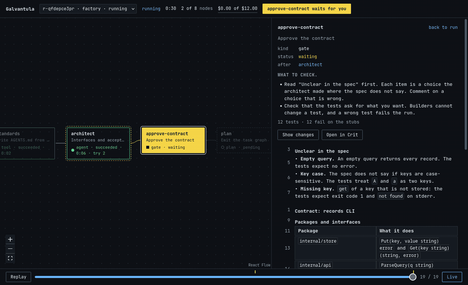

# Galvantula

A software factory. You give it a spec in plain English, and it builds a Go
project. A Go runtime runs a graph of work. Claude Code runs each agent node in
a sandbox. Tests that the builders never see score the result. You approve the
contract and the task graph before the build starts. The event log records
every decision, and a React UI shows each run live.



## Run the demo

The demo uses a fake executor, so it needs no credential. You need Go 1.27 and
Node 22 or later.

```
cd ui && npm ci && npm run build && cd ..
go run ./cmd/factory serve
```

In a second terminal:

```
go run ./cmd/factory start -fake fakes/demo.yaml graphs/demo.yaml
```

Open http://localhost:7070. The run stops at two gates. Decide each one in the
side panel (see [Gates](#gates)). After the second gate, `pkg-store` and
`pkg-api` run at the same time, and `pkg-api` fails once and retries.

To see crash recovery, stop the server while the packages run (Ctrl-C or
`kill -9`), then start it again. The run continues from its event log, and
finished work does not run again.

To step through a run event by event, use **Replay** and the slider.

## Run a real agent

Agents need Linux with bubblewrap (`bwrap`), and Go at `/usr/bin/go` and
`/usr/bin/gofmt`. The sandbox shows only `/usr`, `/etc` and the agent's own
folders, and it finds commands only in `/usr/bin`. It cannot see your home
folder, so agents need their own credential. Make one with `claude setup-token`
(it uses your Claude subscription), or use an API key:

```
export CLAUDE_CODE_OAUTH_TOKEN=...   # or ANTHROPIC_API_KEY=...
go run ./cmd/factory serve
go run ./cmd/factory start -spec evals/wordfreq/spec.md graphs/factory.yaml
```

On macOS, or on any host without `bwrap`, run the server in a Linux container:

1. Put the token from `claude setup-token` in a file named `claude-token`. Git
   ignores it.
2. Run `scripts/docker-factory.sh` in place of `go run ./cmd/factory serve`.
   The image (`docker/Dockerfile`) has bwrap, Go and `claude`. The script gives
   the container the three security options that bwrap needs, and it publishes
   port 7070 to your machine only.
3. Run `factory start` from the host.

**The server's API has no login.** Anyone who can reach it can start agents
with your credential. Run the server only on a machine that you alone use.

The graphs in `graphs/`:

| graph | what it runs |
|---|---|
| `factory.yaml` | the full factory. An architect writes the interfaces, the acceptance tests and `CONTRACT.md`, and you approve the contract. A planner splits the work into tasks, one per group of packages, and you approve the tasks. Independent tasks run at the same time, each in its own worktree, and may not change the tests. The runtime merges a task into main when its check passes. Then a read-only review, a fix, and a verify step that runs the whole suite with the race detector |
| `pipeline.yaml` | `factory.yaml` without the planner: one implementer fills in all the stubs |
| `single.yaml` | one agent builds the product, with no contract and no gates. `factory eval` uses it by default, as the baseline |
| `demo.yaml` | the graph for the fake executor in the demo |

When a task in `factory.yaml` fails its last retry, the runtime removes it and
the tasks that depend on it, and the planner plans their packages again. The
other tasks stay. Each replan makes a new graph version, and the UI's version
menu shows what each version changed.

Each run's product is a git repo in `runs/<run>/repo`. An agent works in
`runs/<run>/nodes/<node>`. The runtime commits and merges its work after the
check passes.

`guardrails.yaml` sets the spend and time limits for each attempt and for the
whole run. `budget.replans` limits replans: past it, a failed task fails the
run. Restart the server after you change the file.

## Gates

A gate stops the run until you approve or reject. Add `-auto-approve` to
`factory start` to skip the gates, as the evals do.

`approve-contract` shows what to check, the test counts (such as
`12 tests · 12 fail on the stubs`), and the contract with numbered lines.
"Unclear in the spec" comes first.

- To comment on a line, press its number, write, and press **Save comment**.
  Your browser keeps the comment as a draft until you decide.
- To send the contract back, reject with notes or comments. The runtime resets
  main to the standards commit. The architect gets your notes, your comments
  with the lines they quote, and the rejected contract.
- The next round shows what the architect changed. **Show changes** marks
  added and removed lines. A comment on a line that did not change stays under
  that line. A comment on a changed line moves to a list above the contract.
- A rejection with no notes and no comments ends the run. So does a rejection
  past `budget.revisions` in `guardrails.yaml`.

`approve-tasks` shows what to check and a table of the tasks: what each owns,
what it waits for, its retries and its cost cap.

### Review a contract in Crit (optional)

[Crit](https://crit.md) is a review tool for text files. When the server
starts, it looks for `crit` on your `PATH`. If it finds it, a contract gate
shows **Open in Crit**.

The button runs Crit on a copy of the contract, with sharing off and a home
folder of its own: `runs/<run>/crit/<gate>/round-<N>/home`. Comment in Crit,
then press **Use Crit comments**. The comments become line comments in the
gate, and you can still edit them. When you decide the gate, the server stops
Crit.

If a killed server leaves Crit running, stop it with that round's home folder:

```
HOME=runs/<run>/crit/<gate>/round-<N>/home crit stop --all
```

## Use the factory from Claude Code

`plugin/` is a Claude Code plugin with an MCP server (`factory mcp`) and a
`/factory` skill. The MCP server calls the factory's HTTP API, so Claude Code
and the UI show the same runs.

| tool | what it does |
|---|---|
| `factory_start` | starts a run from a spec |
| `factory_runs` | lists the runs |
| `factory_status` | shows a run. For each waiting gate, it prints what to check and the contract with line numbers, or the task table |
| `factory_logs` | shows the last log lines of one node or of all nodes |
| `factory_approve` | approves or rejects a gate, with notes. To comment on a line, give its number and quote it |

Install the program once. The plugin runs `factory mcp` from your `PATH`, and
the program contains the graphs:

```
go install ./cmd/factory
```

Start the server from this repo, because it reads `guardrails.yaml` and
`ui/dist` here. Then start Claude Code in any folder:

```
CLAUDE_CODE_OAUTH_TOKEN=... factory serve
claude --plugin-dir /path/to/galvantula/plugin
```

Type `/factory` and describe the program.

## Run the evals

With the server running:

```
go run ./cmd/factory eval -n 10 evals/wordfreq evals/todo evals/csvq
```

The command writes one line per run to `evals/results/<date>.jsonl` and prints
the pass rate, median cost and median time for each eval. The costs are
Claude Code's estimates at API prices, not charges on a plan.
[evals/README.md](evals/README.md) says how the evals work.

## Layout

| path | what it is |
|---|---|
| `graphs/` | the graphs |
| `fakes/` | the fake executor's scripts for `graphs/demo.yaml` |
| `internal/graph` | graph types, validation, and filling a slot with a plan's nodes |
| `internal/event` | event types, the SQLite event log, and the code that rebuilds a run's state from its events |
| `internal/runner` | the runtime: scheduling, worker limit, retries, gates, resume |
| `internal/executor` | the executor interface, the fake executor, and the Claude Code executor with its check |
| `internal/sandbox`, `internal/workspace` | the bubblewrap sandbox; the product repo and its worktrees |
| `internal/server` | the HTTP API and the server-sent event stream |
| `internal/crit` | runs Crit on a copy of a contract and reads its comments |
| `cmd/factory` | `serve`, `start`, `eval`, `mcp`, `validate`, `standards` |
| `cmd/gen-ts` | writes `ui/src/gen/events.ts` from the Go types |
| `cmd/evalgen`, `cmd/phasereview` | writes eval tests and reviews phases, through headless Claude Code (`internal/claude`) |
| `standards/` | the pinned skills and the renderer for the standards block |
| `ui/` | Vite, React and React Flow |
| `evals/` | eval specs and their hidden tests |

The event log is the only state. Each event records a decision of the runtime,
such as whether a failed node will retry. So the UI code that rebuilds state
from events (`ui/src/state.ts`) only copies fields and has no rules of its own.

## Standards and models

`AGENTS.md` holds the rules for every agent in this repo, and `CLAUDE.md`
imports it. Its standards block comes from pinned copies of three skills in
`standards/vendor/`: ponytail (least code), go-modern-guidelines (modern Go)
and orwell-writing (plain English). The standards node writes the same block
into every product. To rewrite the block, run
`go run ./cmd/factory standards -o AGENTS.md`.

`guardrails.yaml` sets the target Go version, the model and effort for each
role, and `concise_output`, which tells agents to keep their replies short.
Sonnet 5.5 builds. Opus 5.5 writes the eval tests and never builds.

## Develop

`AGENTS.md` lists the checks to run before you call a change done, and the
steps that end a phase.

For UI work, run `npm run dev` in `ui/` and open http://localhost:5173. The dev
server sends `/api` to the Go server on port 7070.
